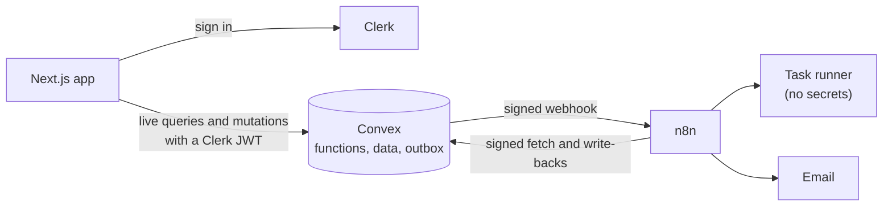
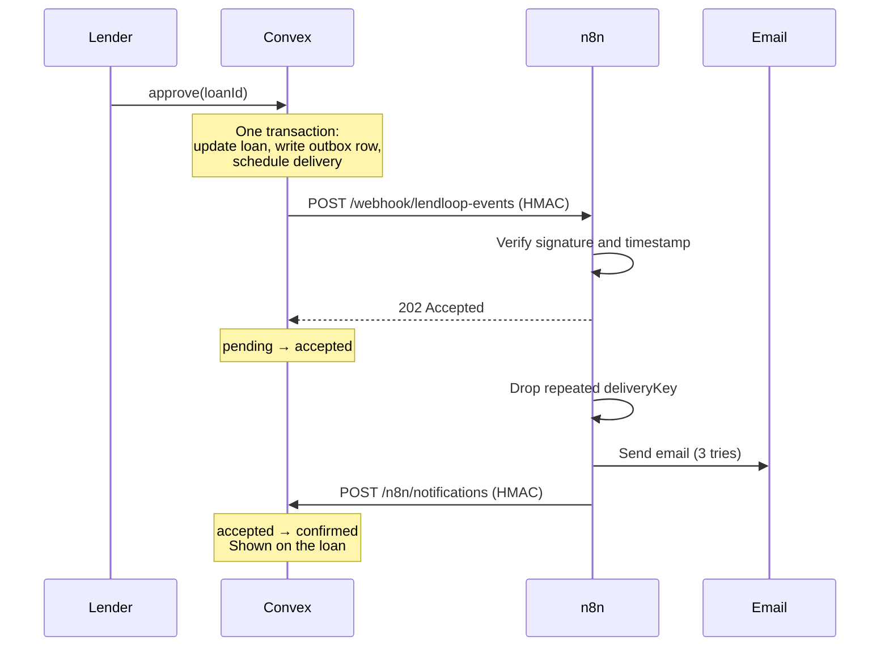

# LendLoop

Borrow what you need. Lend what you don't.

LendLoop is a neighborhood tool-lending board. Neighbors list tools, ask to borrow each other's, and get notifications and overdue reminders through n8n.

The tool wall works like a workshop shadow board: a tool that's available hangs solid on its peg, and a tool that's out leaves a dashed outline behind.

**Stack:** Next.js 16 (App Router), Clerk, Convex, n8n, TypeScript, Tailwind CSS.

## Contents

- [Quick start](#quick-start)
- [Environment variables](#environment-variables)
- [Architecture](#architecture)
- [Roles and access control](#roles-and-access-control)
- [Security decisions](#security-decisions)
- [Data minimization](#data-minimization)
- [Automation and reliability](#automation-and-reliability)
- [Testing](#testing)
- [Known limitations](#known-limitations)
- [Running in production](docs/production.md)

## Quick start

You need Node 24 or later, Docker, and a free [Clerk](https://clerk.com) account. The local setup needs no Convex account and no email provider.

### 1. Install

```bash
npm install
```

### 2. Set up Clerk

1. Create an application in the Clerk dashboard, with email sign-in enabled.
2. Activate the [Convex integration](https://dashboard.clerk.com/apps/setup/convex) and copy the Frontend API URL it shows you.
3. Under **Sessions**, in **Customize session token**, add the claims LendLoop needs to send email:

   ```json
   {
     "email": "{{user.primary_email_address}}",
     "email_verified": "{{user.email_verified}}",
     "given_name": "{{user.first_name}}"
   }
   ```

4. Add your API keys to `.env.local`:

   ```
   NEXT_PUBLIC_CLERK_PUBLISHABLE_KEY=pk_test_...
   CLERK_SECRET_KEY=sk_test_...
   ```

### 3. Start Convex

Create the local deployment. This runs a Convex backend with no account and writes the Convex values to `.env.local`:

```bash
export CONVEX_AGENT_MODE=anonymous
npx convex dev --once
```

This first run stops with `CLERK_JWT_ISSUER_DOMAIN is used in auth config file but its value was not set`. That's expected: Convex won't deploy until it knows which issuer to trust, and the deployment now exists to set it on. Use the Frontend API URL from Clerk:

```bash
npx convex env set CLERK_JWT_ISSUER_DOMAIN https://your-app.clerk.accounts.dev
```

Then start Convex in its own terminal and leave it running. In a new terminal, run the `export` line first:

```bash
npx convex dev
```

In PowerShell, use `$env:CONVEX_AGENT_MODE = "anonymous"` instead of `export`. To use a Convex cloud project, leave that variable unset and see [Using Convex cloud](#using-convex-cloud).

### 4. Start automation

```bash
npm run setup:secrets
docker compose up -d
```

`setup:secrets` generates random secrets into `.env` and gives Convex its half. Compose then starts n8n, its task runner and Mailpit. A one-shot container imports the credentials and workflows and publishes them, so there's nothing to click.

| Service | URL | Notes |
| --- | --- | --- |
| n8n editor | http://localhost:5678 | Create the owner account on first visit |
| Mailpit | http://localhost:8025 | Every email the workflows send lands here |

### 5. Add demo data and run the app

```bash
npx convex run seed:demo
npm run dev
```

Open http://localhost:3000. Seeding fills the wall, creates an overdue loan, and sends one real request through the pipeline, so an email appears in Mailpit straight away.

### 6. Make yourself an admin

Sign in once, copy your user ID from the Clerk dashboard, then run:

```bash
npx convex run admin:setRole '{"clerkId":"user_xxx","role":"admin"}'
```

Roles can't be granted from the app. See [Roles and access control](#roles-and-access-control).

### Trying the reminder workflow

The overdue workflow runs daily at 08:00 UTC. To run it now, open **LendLoop: overdue reminders** in n8n and click **Execute workflow**. The reminder appears in Mailpit, and on the loan as "Reminder sent just now". A second run sends nothing, because each loan gets one reminder per day.

### Using Convex cloud

Convex cloud can't reach n8n on `localhost`, so n8n needs a public HTTPS URL, for example through a Cloudflare Tunnel:

```bash
N8N_WEBHOOK_URL=https://your-tunnel.example.com/webhook/lendloop-events npm run setup:secrets
```

Then set `LENDLOOP_CONVEX_SITE_URL=https://<deployment>.convex.site` in `.env` and run `docker compose up -d --force-recreate`.

## Environment variables

**`.env.local`, for Next.js.** See [.env.local.example](.env.local.example).

| Variable | Purpose |
| --- | --- |
| `NEXT_PUBLIC_CLERK_PUBLISHABLE_KEY` | Clerk key for the browser |
| `CLERK_SECRET_KEY` | Clerk key for the server |
| `CONVEX_DEPLOYMENT` | Written by `npx convex dev` |
| `NEXT_PUBLIC_CONVEX_URL` | Written by `npx convex dev` |
| `NEXT_PUBLIC_CONVEX_SITE_URL` | Written by `npx convex dev` |

**Convex deployment, set with `npx convex env set`.**

| Variable | Purpose |
| --- | --- |
| `CLERK_JWT_ISSUER_DOMAIN` | The Clerk issuer Convex trusts |
| `N8N_WEBHOOK_URL` | Where loan events are sent |
| `LENDLOOP_TO_N8N_SECRET` | Signs requests from Convex to n8n |
| `N8N_TO_LENDLOOP_SECRET` | Verifies requests from n8n to Convex |
| `CLERK_WEBHOOK_SECRET` | Optional. Verifies Clerk webhooks. Without it, the endpoint refuses requests |

**`.env`, for Docker Compose.** Generated by `npm run setup:secrets`. See [.env.example](.env.example).

| Variable | Purpose |
| --- | --- |
| `N8N_ENCRYPTION_KEY` | Encrypts credentials stored in n8n |
| `N8N_RUNNERS_AUTH_TOKEN` | Authenticates the task runner to n8n |
| `LENDLOOP_TO_N8N_SECRET` | Same value as on Convex |
| `N8N_TO_LENDLOOP_SECRET` | Same value as on Convex |
| `LENDLOOP_CONVEX_SITE_URL` | Where n8n reaches Convex HTTP actions |
| `SMTP_*`, `LENDLOOP_OPS_EMAIL` | Optional. Defaults use Mailpit |

## Architecture



### Why it's built this way

| Decision | Reasoning |
| --- | --- |
| Authorization lives in Convex, not in Next.js | The browser talks straight to Convex, so a check in Next.js could be bypassed. Convex is the one place every read and write passes through. |
| One `loans` table holds requests and loans | A request becomes a loan by changing status, so there's no copying between tables and one state machine covers the lifecycle. |
| `tools.status` is stored, not computed on read | Convex re-runs queries when data changes, not when the clock passes midnight. An hourly cron moves a tool to "on loan" when a booked loan starts. |
| Transactional outbox | A mutation can't call the network. The event is written in the same transaction as the loan change, so it can't be lost, and it can't be sent for a change that rolled back. |
| n8n acknowledges first and reports back later | Convex learns "accepted" in milliseconds, without waiting on mail retries. The signed write-back then confirms the real outcome, so "accepted" is never mistaken for "sent". |
| Loan dates are UTC calendar days | A loan is a range of days, and a stored `YYYY-MM-DD` can't drift between time zones. |

### The notification flow



### Project layout

```
convex/
  lib/functions.ts     Access-control wrappers: the entry point for every function
  lib/policies.ts      Who may touch what, and the loan state machine
  lib/signing.ts       HMAC signing and verification
  lib/domain.ts        Shared vocabulary and date rules, also used by the UI
  tools.ts, loans.ts   Listings and the loan lifecycle
  admin.ts             Admin-only functions
  outbox.ts            Delivery to n8n, with retries
  automation.ts        Idempotent write-backs from n8n
  http.ts              Signed HTTP routes and the Clerk webhook
  crons.ts             Outbox sweep, availability sync, retention
n8n/
  workflows/           Exported workflow JSON
  bootstrap/           Imports credentials and workflows on startup
src/
  app/                 Public page and the signed-in routes
  components/          The tool wall, sheets and loan rows
tests/convex/          Backend tests
scripts/               Secret setup, workflow scan, webhook smoke test
```

## Roles and access control

| Action | Signed out | User | Admin |
| --- | --- | --- | --- |
| See available tools (name and category) | Yes | Yes | Yes |
| See the full wall and filter by category | | Yes | Yes |
| List a tool | | Yes | Yes |
| Edit or delete a listing | | Own only | Own only |
| Remove any listing | | | Yes |
| Request to borrow | | Yes, not own tools | Yes, not own tools |
| Approve or decline a request | | Lender only | Lender only |
| Mark a loan as returned | | Lender only | Lender only |
| Cancel a request | | Borrower only | Borrower only |
| View all loans | | | Yes |
| Mark a Trusted Lender | | | Yes |
| View automation health and retry deliveries | | | Yes |

How it's enforced:

- **Every function declares its access level.** Each one is built from `publicQuery`, `userQuery`, `userMutation`, `adminQuery` or `adminMutation` in [convex/lib/functions.ts](convex/lib/functions.ts). The auth check runs before the handler, so it can't be forgotten.
- **Lint blocks the bypass.** ESLint rejects importing Convex's raw `query` and `mutation` builders anywhere else.
- **Ownership is checked per record** in [convex/lib/policies.ts](convex/lib/policies.ts), after the role check.
- **Roles live in Convex, not in Clerk metadata or the token.** Revoking access takes effect on the next call, with no token to wait out.
- **No app path grants a role.** `admin:setRole` is an internal function that needs deployment credentials. It targets the immutable Clerk user ID, because emails can change and be reused.
- **Admins don't get lender powers.** An admin can remove a listing but can't approve someone else's loan. The brief gives them specific powers, not all of them.

Only the lender can mark a loan returned, for two reasons: only they know the tool came back, and a borrower who could do it could also turn off their own overdue reminders.

## Security decisions

**Requests between Convex and n8n**

- Each request carries an HMAC-SHA256 signature over `timestamp.METHOD.path.rawBody`. Including the method and path stops a captured signature being replayed against another endpoint.
- Timestamps must be within five minutes, which limits how long a captured request stays useful.
- Comparison is constant-time on both sides: `crypto.subtle.verify` in Convex and `timingSafeEqual` in n8n.
- Each direction has its own secret, so leaking one doesn't allow forging the other.
- Convex fails closed: with no secret configured, the endpoint returns 503 rather than accepting requests.
- Every rejection looks identical to the caller, and bodies are parsed only after verification.
- Outbound delivery uses `redirect: "error"`, so a signed payload can't be redirected elsewhere.

**Secrets**

- Signing keys live in n8n's encrypted credential store, so they can't appear in exported workflow JSON.
- A one-shot container loads them on startup. It's the only container that sees them as environment variables: neither the running n8n process nor the task runner has them.
- [scripts/check-workflows.mjs](scripts/check-workflows.mjs) runs in CI and fails on anything that looks like a secret, on embedded credential data, on pinned data, and on missing retries or error handling.
- `.env` files are ignored by git, and Docker ports bind to `127.0.0.1` only.

**The web app**

- The Content-Security-Policy uses a per-request nonce and `strict-dynamic`, so injected scripts can't run. The header is set in [src/proxy.ts](src/proxy.ts).
- `frame-ancestors 'none'`, HSTS, `nosniff`, a strict referrer policy and a locked-down permissions policy are also set.
- Convex validators check types, and domain rules check everything else: text length, control characters, real calendar dates, loan length and how far ahead someone can book.
- Limits on pending requests and listings keep one account from flooding the notification pipeline.
- Errors shown to users are written for them. Internal detail stays in server logs.

**Accountability**

- Privileged and state-changing actions go into an append-only `auditLog`, with the actor, action and target.
- Clerk webhooks are verified with Svix signatures.
- Only verified email addresses are stored.

## Data minimization

| Where | What's kept out, and why |
| --- | --- |
| Public query | Returns only `id`, `name` and `category`. It maps to an explicit shape instead of returning the document, so a new column can't leak by accident. |
| Other users | People see a first name and the Trusted Lender badge. Emails are never returned to any browser, including for admins, because no task needs them. |
| Booked dates | Borrowers see which dates are taken, not who took them. |
| Outbox | Stores IDs only. The email address is read at send time, so no personal data sits in a queue and a later account deletion is respected. |
| Notification payload | A first name, an email address, the tool name and the dates. The other party's identity isn't included. |
| Reminder payload | The same, plus the due date. The lender isn't identified. |
| n8n execution data | Successful runs aren't stored. Failed runs are kept for debugging and pruned after seven days. |
| Error reports | Email addresses are masked, and messages are cut to 300 characters before leaving n8n. |
| Retention | Settled outbox rows are deleted after 30 days and failure records after 90. |
| Account deletion | A verified Clerk webhook erases the name and email, removes the person's listings and cancels their open requests. The anonymous row stays, so other people's loan history still makes sense. |

## Automation and reliability

Three workflows live in [n8n/workflows](n8n/workflows):

| Workflow | Trigger | What it does |
| --- | --- | --- |
| Request notifications | Signed webhook from Convex | Verifies, de-duplicates, emails the right person, reports the result |
| Overdue reminders | Daily at 08:00 UTC | Fetches overdue loans, emails each borrower, writes each result back |
| Error handler | Any failed run | Records the failure in Convex and alerts operations by email |

### Idempotency

Delivery is at-least-once, so every step tolerates repeats:

- **Webhook retries:** n8n de-duplicates on `deliveryKey`.
- **Write-backs:** `loanActivity` is unique on an idempotency key, so a replay changes nothing.
- **Reminders:** the key is `reminder:<loanId>:<date>`, which gives one per loan per day however many times the workflow runs.
- **Ordering:** "sent" is terminal. A late failure report can't overwrite a success, while a retry that succeeds does upgrade an earlier failure.
- **Manual retries:** a new generation changes `deliveryKey` while keeping `eventId`, so de-duplication lets it through on purpose.

### What happens when something fails

Failed work always ends up somewhere a person can see it. Admins get an Automation panel in the app listing all of this, with a retry button for failed deliveries.

| Failure | What happens | Where it shows |
| --- | --- | --- |
| n8n is down | Convex retries at 30s, 2m, 10m, 1h and 6h, then gives up | Admin panel, on the loan |
| n8n recovers during retries | The next retry delivers, with no intervention | Normal confirmation |
| The mail server is down | n8n tries 3 times, reports failure, raises an error | Admin panel, on the loan, error workflow |
| One reminder fails | The rest continue, and that failure is written back | Admin panel, on the loan |
| n8n accepts an event, then crashes | A sweep fails anything unconfirmed after 15 minutes | Admin panel |
| A delivery action crashes | A cron re-dispatches stranded rows every 5 minutes | Normal retry |
| The daily schedule stops firing | Nothing errors, so each poll records a heartbeat instead | Admin panel warns after 26 hours |
| An account has no email address | Its notifications are skipped | Admin panel shows a count |
| A workflow fails | The error workflow records it and emails operations | Admin panel, ops inbox |

The heartbeat matters because a schedule that never fires produces no errors at all, so an error workflow alone would never notice.

## Testing

```bash
npm run check          # lint, types, backend tests, workflow scan
npm test               # backend tests only
npm run smoke:webhook  # attacks the running n8n webhook
```

The backend tests run against real Convex functions and cover access control for each role, the loan state machine, date rules, signature handling, idempotency, retries and data minimization.

`smoke:webhook` needs Docker running. It sends unsigned, wrongly signed, tampered, replayed and misdirected requests to the live webhook, then checks that a repeated delivery produces one email. Its valid event has an ID Convex has never seen, so that run fails at the write-back on purpose, which also exercises the error workflow.

## Known limitations

These are deliberate choices for a take-home, and most have a fix in the [production notes](docs/production.md).

- **A narrow double-send window.** If n8n crashes after sending an email but before recording it, a retry could send it again. Delivery is at-least-once, and a duplicate notification is better than a lost one.
- **Replays within five minutes.** The timestamp window doesn't stop a replay inside it. Write-backs are idempotent, so a replay changes nothing, which is why there's no nonce store.
- **n8n reads one URL through `$env`.** That requires `N8N_BLOCK_ENV_ACCESS_IN_NODE=false`. The risk is limited because the running n8n has no signing secrets in its environment, though it does hold `N8N_ENCRYPTION_KEY`, so workflow editors must be trusted.
- **Reminders are UTC-based.** A loan can turn overdue in the evening for someone west of UTC.
- **No pagination.** Lists are capped, which is fine at neighborhood scale.
- **Local n8n uses SQLite** and a single process.
